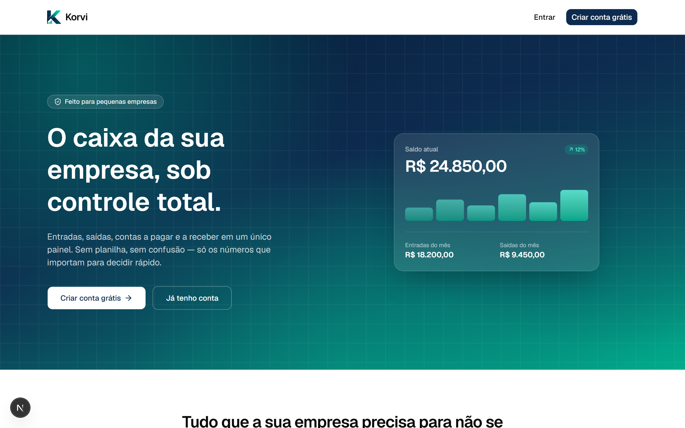

<div align="center">


# Korvi

**Gestão financeira inteligente para pequenas empresas**

Controle de caixa, contas a pagar e a receber e relatórios financeiros em um só lugar — simples, moderno e sem planilha.

[](https://nextjs.org)
[](https://www.typescriptlang.org)
[](https://www.prisma.io)
[](https://vercel.com)

</div>



## Funcionalidades

- **Dashboard**: saldo atual, entradas/saídas do mês, fluxo de caixa dos
  últimos 6 meses, despesas por categoria e alertas de contas a vencer.
- **Caixa**: lançamentos de entrada e saída, com filtros por tipo, categoria
  e período.
- **Contas a Pagar / Contas a Receber**: controle de vencimentos, com baixa
  automática que gera o lançamento correspondente no caixa (sem digitar duas
  vezes).
- **Categorias**: organização própria de entradas e saídas.
- **Relatórios**: comparativo mensal, distribuição por categoria e
  exportação em CSV.
- **Autenticação completa**: cadastro com validação de CNPJ, login,
  recuperação de senha por e-mail.
- Modo claro/escuro e layout responsivo (funciona bem no celular).

## Stack técnica

- [Next.js 16](https://nextjs.org) (App Router) + TypeScript
- Tailwind CSS + [shadcn/ui](https://ui.shadcn.com) (base [Base UI](https://base-ui.com))
- [Prisma](https://www.prisma.io) + Postgres (hospedado no [Neon](https://neon.tech),
  provisionado via integração da Vercel)
- Autenticação própria (e-mail/senha) com cookie de sessão assinado
  (`jose` + `bcryptjs`)
- [Resend](https://resend.com) para e-mails transacionais (recuperação de senha)
- [Recharts](https://recharts.org) para os gráficos
- Publicado na [Vercel](https://vercel.com)

## Como rodar localmente

Pré-requisitos: [Node.js](https://nodejs.org) 20.9 ou superior e um banco
Postgres (local ou hospedado, ex: [Neon](https://neon.tech)).

```bash
# 1. Instalar dependências
npm install

# 2. Copiar o exemplo de variáveis de ambiente e preencher os valores
cp .env.example .env

# 3. Aplicar as migrações
npx prisma migrate dev

# 4. Popular o banco com um usuário e categorias iniciais
npx prisma db seed

# 5. Rodar o servidor de desenvolvimento
npm run dev
```

Acesse [http://localhost:3000](http://localhost:3000). O comando de seed
imprime no terminal o e-mail e a senha do usuário padrão criado — troque
essa senha (ou crie sua própria conta pela tela de cadastro) antes de usar
em produção.

## Build de produção

```bash
npm run build
npm run start
```

## Estrutura do projeto

```
prisma/                   Schema, migrações e seed do banco de dados
src/app/page.tsx          Home pública (landing page)
src/app/login/            Login, cadastro, recuperação de senha
src/app/(app)/            Páginas autenticadas (dashboard, caixa, contas, etc.)
src/components/           Componentes de UI e de cada módulo
src/lib/actions/          Server Actions (mutações do banco)
src/lib/data/             Consultas e agregações para dashboard/relatórios
src/lib/session.ts        Autenticação e cookie de sessão
src/proxy.ts              Protege as rotas autenticadas
```

## Variáveis de ambiente

Veja `.env.example`:

- `DATABASE_URL`: conexão Postgres *pooled*, usada pela aplicação em tempo
  de execução.
- `DATABASE_URL_UNPOOLED`: conexão Postgres direta, usada pelo Prisma CLI
  para rodar migrações (configurada em `prisma.config.ts`).
- `AUTH_SECRET`: chave usada para assinar o cookie de sessão. Gere uma nova
  com:
  ```bash
  node -e "console.log(require('crypto').randomBytes(32).toString('hex'))"
  ```
- `RESEND_API_KEY`: chave da API do [Resend](https://resend.com), usada para
  enviar o e-mail de recuperação de senha.

Em produção (Vercel), essas variáveis já ficam configuradas automaticamente
pela integração do banco de dados (Neon), pela integração do Resend e por
`vercel env add`.

## Licença

Todos os direitos reservados. Código publicado para fins de portfólio —
uso, cópia ou redistribuição não são permitidos sem autorização.
